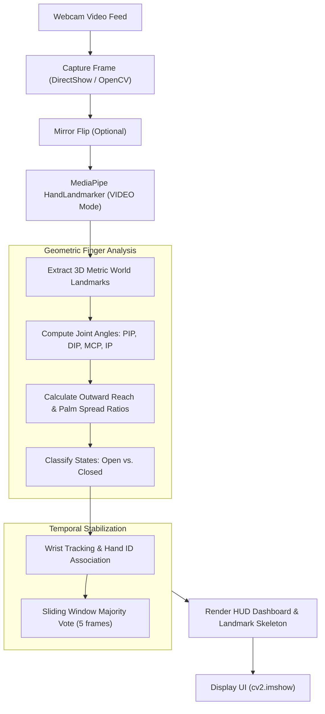

# 🖐️ Real-Time Hand & Finger Tracker

A lightweight, self-contained Python application for real-time webcam hand tracking and open/closed finger state estimation powered by Google MediaPipe and OpenCV.

---

## ✨ Features

- **Multi-Hand Tracking**: Detects and tracks up to 2 hands simultaneously in real time.
- **3D Metric Joint Geometry**: Analyzes 3D world landmarks (metric coordinates) rather than naive 2D screen positions. This provides robust finger state detection regardless of hand tilt, pitch, or rotation.
- **Per-Finger State Estimation**: Accurately classifies each finger (*Thumb*, *Index*, *Middle*, *Ring*, *Pinky*) as **OPEN** (green) or **CLOSED** (orange).
- **Temporal Anti-Flicker Smoothing**: Employs nearest-neighbor wrist tracking across frames combined with a sliding-window majority vote to eliminate detection flicker.
- **Split-Screen HUD Dashboard**: Displays the camera feed with skeletal landmark overlays alongside an information panel featuring live FPS, total open/closed counts, and per-finger telemetry.
- **Privacy-First & Offline Ready**: Automatically downloads Google's ~8 MB `hand_landmarker.task` model to local cache on the first launch. All subsequent tracking runs 100% offline on your local machine—no frames or data are ever uploaded or saved.

---

## 📋 System Requirements

- **Operating System**: Windows 10/11, macOS, or Linux.
- **Python**: **Python 3.10, 3.11, or 3.12 (64-bit)** recommended.
  > *Note*: MediaPipe pre-built binary wheels have optimal support for Python 3.10–3.12.
- **Hardware**: A working built-in or USB external webcam.

---

## 🚀 Quick Start / How to Run

### Option 1: Using `uv` (Recommended — Fastest Setup)

If you have [`uv`](https://github.com/astral-sh/uv) installed:

```bash
# 1. Create a Python 3.11 virtual environment
uv venv --python 3.11

# 2. Install dependencies
uv pip install -r requirements.txt

# 3. Run the tracker
.venv\Scripts\python tracker.py        # Windows
# or on macOS/Linux:
# .venv/bin/python tracker.py
```

---

### Option 2: Standard Python (`venv` + `pip`)

#### Windows (PowerShell or Command Prompt):
```powershell
# 1. Create a virtual environment
py -3.11 -m venv .venv
# (or: python -m venv .venv)

# 2. Activate the virtual environment
.venv\Scripts\activate

# 3. Install required packages
python -m pip install --upgrade pip
python -m pip install -r requirements.txt

# 4. Run the tracker
python tracker.py
```

#### macOS / Linux:
```bash
# 1. Create a virtual environment
python3 -m venv .venv

# 2. Activate the virtual environment
source .venv/bin/activate

# 3. Install required packages
python -m pip install --upgrade pip
python -m pip install -r requirements.txt

# 4. Run the tracker
python tracker.py
```

---

### Option 3: PyCharm

1. Open this folder in **PyCharm**.
2. Configure a Python interpreter with **Python 3.11 or 3.12 (64-bit)** (*Settings > Project: hand tracker > Python Interpreter*).
3. In PyCharm's bottom **Terminal**, run:
   ```bash
   python -m pip install -r requirements.txt
   ```
4. Right-click [`tracker.py`](tracker.py) in the project tree and click **Run 'tracker'**.

---

### Option 4: Visual Studio Code

1. Open this directory in VS Code.
2. Press `Ctrl+Shift+P` (or `Cmd+Shift+P` on macOS) and choose **Python: Select Interpreter**, then pick your Python 3.11/3.12 virtual environment.
3. Open an integrated terminal (`Ctrl+` `) and install dependencies:
   ```bash
   pip install -r requirements.txt
   ```
4. Open [`tracker.py`](tracker.py) and press `F5` (or click the Run button at top right).

---

## 🎮 Controls & Keyboard Shortcuts

*(Make sure to click inside the tracking window to focus it first)*

| Key | Action | Description |
|:---:|:---|:---|
| **`Q`** or **`Esc`** | **Quit** | Closes the camera and exits the application cleanly. |
| **`M`** | **Toggle Mirror** | Switches between selfie mirror mode (default) and standard camera view. Handedness labels (Left / Right) automatically adapt. |
| **`R`** | **Reset Tracking** | Resets the temporal smoothing buffer and hand ID tracking history. |

---

## 🧠 How It Works



1. **Model Download & Validation**: On first execution, `ensure_model()` downloads Google's `hand_landmarker.task` to your system cache directory (`%LOCALAPPDATA%/HandFingerTracker/` on Windows) and validates its internal TFLite model signatures (`hand_detector.tflite` and `hand_landmarks_detector.tflite`).
2. **3D Landmark Inference**: MediaPipe estimates 21 landmarks per hand in normalized screen coordinates (for overlay rendering) and in **3D metric world coordinates** (meters relative to palm center).
3. **Geometric Analysis**:
   - **Thumb**: Evaluates MCP and IP extension angles alongside thumb-to-palm spread distance ratio.
   - **Fingers**: Evaluates Proximal Interphalangeal (PIP) and Distal Interphalangeal (DIP) joint straightness angles, combined with an outward reach test relative to the wrist to prevent curled fingers across the palm from falsely registering as open.
4. **State Smoothing**: The `StateSmoother` tracks wrists across frames using greedy nearest-neighbor matching and applies a short majority vote (`SMOOTHING_FRAMES = 5`) to ensure a stable, flicker-free reading.

---

## ⚙️ Configuration & Customization

You can adjust tracking settings directly at the top of [`tracker.py`](tracker.py):

```python
# ------------------------- Easy-to-change settings -------------------------
CAMERA_INDEX = 0          # 0 = Built-in webcam, 1 or 2 = External USB camera
MIRROR = True             # True for selfie view (mirror), False for forward view
CAMERA_WIDTH = 960        # Capture resolution width
CAMERA_HEIGHT = 540       # Capture resolution height
MAX_HANDS = 2             # Maximum hands to detect (1 or 2)
SMOOTHING_FRAMES = 5      # Number of frames for majority vote smoothing

# Joint angle thresholds (in degrees; straight joint ~ 180°)
FINGER_PIP_ANGLE = 140    # PIP angle to consider finger extended
FINGER_DIP_ANGLE = 120    # DIP angle to consider finger extended
THUMB_MCP_ANGLE = 140     # Thumb MCP extension threshold
THUMB_IP_ANGLE = 150      # Thumb IP extension threshold
THUMB_MIN_SPREAD = 0.55   # Thumb spread ratio relative to palm width
```

---

## 🛠️ Troubleshooting

### 1. `Cannot read webcam 0`
- **External Camera**: If using a USB webcam, change `CAMERA_INDEX = 0` to `CAMERA_INDEX = 1` in `tracker.py`.
- **Camera Occupied**: Ensure other programs (Zoom, Teams, Skype, Windows Camera app) are not using your camera.
- **Windows Privacy Settings**: Go to **Windows Settings > Privacy & security > Camera** and ensure **"Let desktop apps access your camera"** is toggled **ON**.

### 2. MediaPipe installation errors or `Could not load a required package`
- MediaPipe tasks run reliably on **64-bit Python 3.10, 3.11, or 3.12**.
- If using Python 3.13+ and wheels are not yet available for your platform, create a Python 3.11 virtual environment using `uv venv --python 3.11` or `py -3.11 -m venv .venv`.

### 3. Model download failure on first run
- Ensure you have an active internet connection on the initial launch so the script can download the ~8 MB Google model file.
- If behind a proxy or firewall, you can manually download:
  `https://storage.googleapis.com/mediapipe-models/hand_landmarker/hand_landmarker/float16/1/hand_landmarker.task`
  and place it at:
  - **Windows**: `%LOCALAPPDATA%\HandFingerTracker\hand_landmarker.task`
  - **macOS / Linux**: `~/.cache/HandFingerTracker/hand_landmarker.task`

### 4. Finger counts inaccurate or flickering
- **Lighting**: Ensure your hand is evenly illuminated with sufficient contrast against the background.
- **Full View**: Keep the wrist and all five fingertips fully visible within the frame.
- **Distance**: Maintain a comfortable distance (0.5 to 1.5 meters) from the lens.

---

## 📂 Project Structure

```
hand tracker/
├── .gitignore              # Ignores venv, caches, and build files
├── README.md               # Comprehensive documentation and run guide
├── requirements.txt        # Project dependencies
└── tracker.py              # Main tracker application
```

---

## 🔒 Privacy & Security

- **100% On-Device Processing**: Inference executes entirely within your local CPU/GPU using Google's local TFLite runtime.
- **No Video Recording or Telemetry**: Webcam video frames are processed in-memory in real time and are never saved to disk, transmitted over the network, or sent to external servers.
